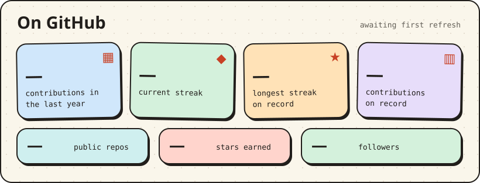
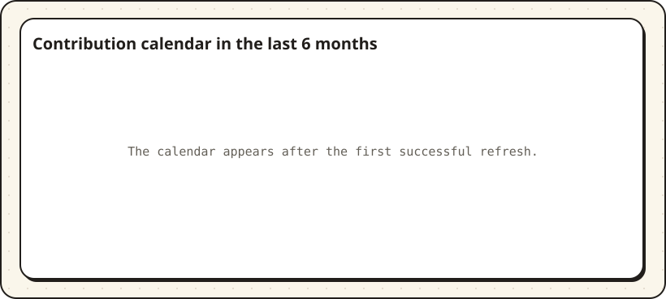
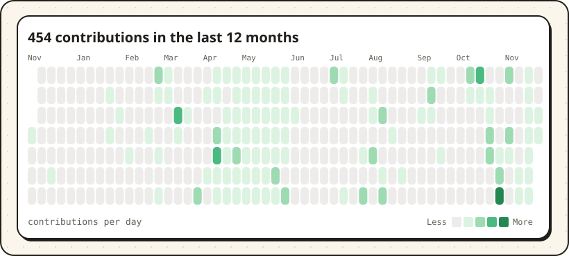
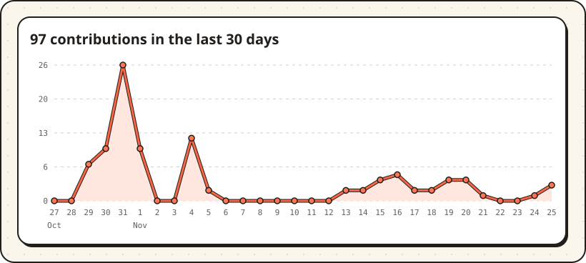
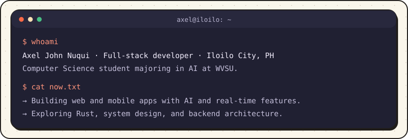
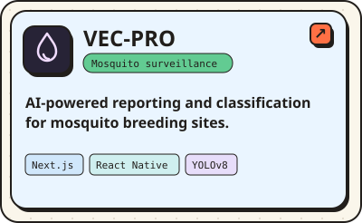
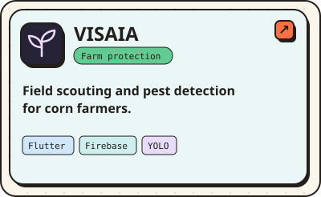
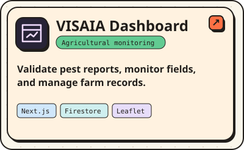
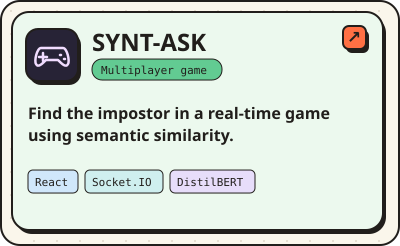
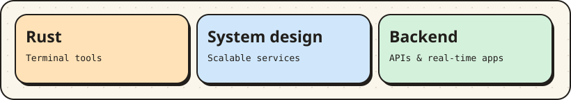

  
  
  

<!-- activity:start -->

Last 12 months

<!-- activity:end -->

  
  
  
  

  More work · <a href="https://revia-npk.vercel.app/">Revia</a> · <a href="https://github.com/xelpaxu/aedex">Aedex</a> · <a href="https://github.com/xelpaxu/aedify">Aedify</a> · <a href="https://github.com/xelpaxu/amogus">SYNT-ASK source</a>

GitHub activity refreshed nightly · <a href="https://xlpxu.vercel.app/">Portfolio</a>

